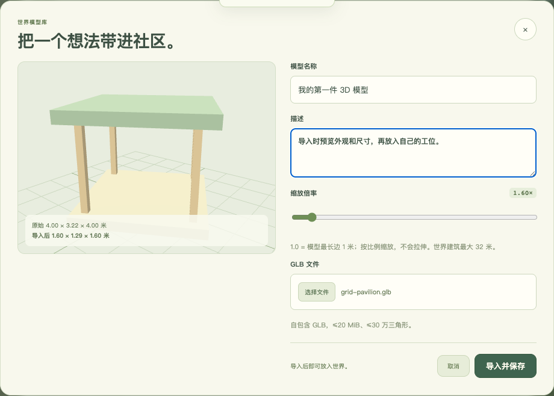

# 3D 模型导入与工位迷你世界编辑器



## 1. 两个层级

| 层级 | 谁使用 | 模型归属 | 放置范围 |
| --- | --- | --- | --- |
| 世界编辑器 | 管理员 | 社区共享 | 整个 280×280 世界，可调整占地、朝向、碰撞 |
| 工位迷你编辑器 | 登录用户 | 个人私有 / 管理员共享 | 自己的 5×5 米工位 |

用户导入的模型默认是**私有的**：只有本人能在自己的工位里看到和摆放，不会出现在其他访客的世界快照中，也不能被放入公共世界。管理员导入的模型是**社区共享**的，所有用户都可以在自己的工位里使用，也可以放入世界布局。

## 2. 导入流程

入口：

- 用户：**我的账号 → 打开我的背包 → 我的 3D 模型 → 导入 3D 模型**；
  也可以在自己的工位编辑器中点“导入模型”。
- 管理员：**管理后台 → 世界与模型 → 进入世界建造编辑器 → 我的模型库 → 导入模型**。

导入对话框包含：

1. **GLB 文件**：自包含 `.glb`，自动检查文件头、外部 URI、压缩格式、节点/顶点/三角形上限。
2. **名称**：最多 40 个字符。
3. **描述**：最多 160 个字符，会显示在模型库和背包里。
4. **缩放倍率**：按比例缩放，不拉伸。`1.0 = 模型最长边 1 米`。
   - 用户：`0.1–3.5`
   - 管理员：`0.5–32`
5. **3D 预览**：选择文件后立即在右侧预览，自动旋转、底部贴地；下方显示原始尺寸和导入后尺寸。

导入成功后，模型进入当前账号可用的模型库，不会立刻出现在世界里；需要再点“放入世界”或“放入工位”。

## 3. 尺寸与占地

GLB 的原始包围盒由服务端从 POSITION accessor 计算，并结合节点平移、旋转、缩放，避免客户端伪造尺寸。

```text
最长边 = max(原始宽, 原始高, 原始深)
渲染缩放 = 用户选择的缩放倍率 / 最长边
导入后最长边 = 缩放倍率（米）
```

例如原始模型最长边为 4 米：

- 缩放 1.0 → 最长边 1 米
- 缩放 2.0 → 最长边 2 米
- 缩放 0.5 → 最长边 0.5 米

世界编辑器中，模型的默认占地由导入后尺寸向上取整得到；占地不能小于模型实际宽深，否则会拒绝保存。

工位编辑器中，模型必须完整落在工位边界内，单个工位最多放 8 个 3D 模型。

## 4. 个人模型限制

| 限制 | 用户 | 管理员 |
| --- | --- | --- |
| 文件大小 | 5 MiB | 20 MiB |
| 三角形 | 8 万 | 30 万 |
| 单模型最长边 | 3.5 米 | 32 米 |
| 每人模型数 | 20 | — |
| 库总量 | 200 | 300 |
| 可见性 | 私有 | 共享 |

## 5. 工位迷你编辑器

自己的工位现在支持两类物品：

- **家具目录**：原木书桌、椅子、电脑、绿植等固定家具，仍受背包持有数量限制。
- **3D 模型**：从“我的 3D 模型”中添加，支持在 3D 世界中直接点选拖动、X/Z 精调、旋转、收回；保存后跟随账号持久化。

模型渲染使用真实比例，参与工位碰撞；桌面家具规则不变。只有工位主人且抵达工位入口后才能保存，服务器会再次校验模型归属、数量、尺寸和边界。

## 6. 删除模型

用户可以在背包中删除自己的模型。以下情况会拒绝删除：

- 模型正在被某个工位摆放；
- 模型正在被世界布局中的建筑使用。

管理员删除共享模型时同样会检查引用。

## 7. 数据字段

`community_state.modelAssets` 中每个资源新增：

```json
{
  "id": "uuid",
  "name": "我的小书架",
  "description": "放在工位右侧的矮书架。",
  "filename": "shelf.glb",
  "url": "/uploads/<uuid>.glb",
  "width": 1.2,
  "height": 2.0,
  "depth": 0.4,
  "scale": 1.6,
  "bounds": { "width": 1.2, "height": 2.0, "depth": 0.4, "min": [], "max": [] },
  "ownerId": "user-uuid",
  "visibility": "private",
  "bytes": 123456,
  "triangleCount": 1200,
  "createdAt": 0
}
```

旧模型没有 `scale` / `visibility` 时自动按共享资源兼容；旧的世界建筑继续使用“适配占地”的渲染方式。缺失、空值或非正数缩放统一保留为 `null`，重复加载也不会变成零缩放。

私有模型下载响应使用 `Cache-Control: private, no-store`，每次下载均校验所有者或管理员权限；共享模型继续使用长期公共缓存。

## 8. 接口

| 方法 | 路径 | 权限 | 说明 |
| --- | --- | --- | --- |
| GET | `/api/models` | 登录用户 | 自己的私有模型 + 共享模型；管理员返回全部 |
| POST | `/api/models` | 登录用户 | 上传私有模型，query 带 `filename/name/description/scale` |
| DELETE | `/api/models/:id` | 所有者/管理员 | 删除未被引用的模型 |
| POST | `/api/admin/models` | 管理员 | 上传共享模型 |
| GET | `/api/world` | 公开 | 只返回共享模型，不泄露他人私有模型 |
| PATCH | `/api/offices/:id` | 工位主人 | 家具数组中可使用 `model:<assetId>` |

## 9. 验证

后续更新：模型卡片支持编辑名称、描述和缩放，不需要再次上传 GLB；放大后会校验已有工位和公共建筑占地。新导入或编辑模型会生成 160×120 PNG 缩略图。卡片显示引用数量，已有摆放时禁止删除。旧资源可通过一次“编辑模型 → 保存模型”生成缩略图。

工位编辑器不再使用虚拟平面画板；点选 3D 家具后拖动布置，R 旋转 15°，Delete 收回背包，空白处拖动转视角、右键拖动平移、滚轮缩放。触屏可直接拖动物件，底部半高面板保留可操作场景。无效拖动结束或触控取消会恢复原位；撤销历史和重做分支也会保留。

工位编辑器支持 0.25 米吸附、撤销/重做、复制物品，以及前后端一致的即时数量和越界检查。错误时保存按钮禁用；关闭或取消会恢复已保存布置。

- 服务端测试覆盖：私有模型上传、世界快照不泄露、所有者工位摆放、管理员共享模型与占地校验。
- 回归测试覆盖：旧模型反复迁移后仍适配占地、新模型保持指定缩放、私有下载禁止缓存及跨账号访问拦截。
- Playwright 覆盖：管理员登录、进入世界、家具保存、贴纸墙、世界布局，以及“导入 GLB → 预览 → 缩放 → 放入工位 → 保存”“管理员把同一模型放入世界布局”和“普通用户导入私有模型并在工位中渲染”。
