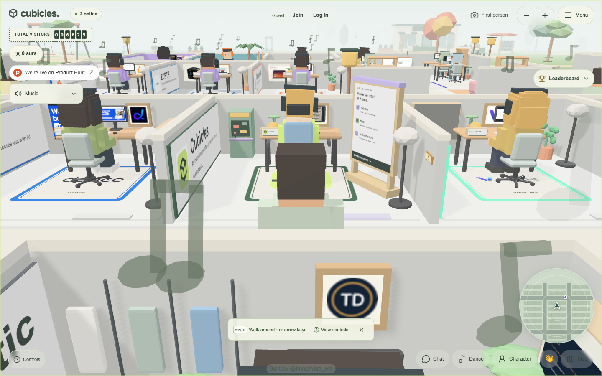
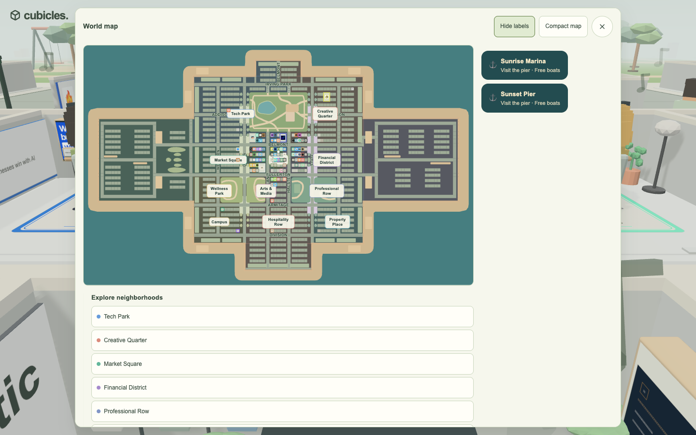
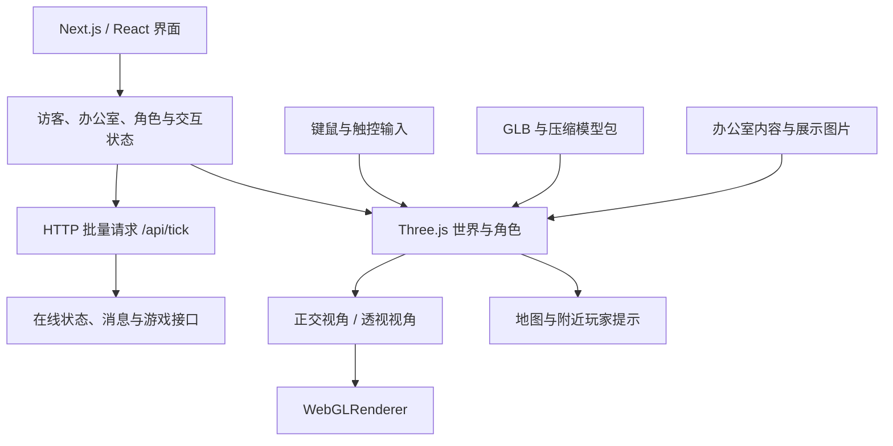

# Cubicles 网站 REA 技术拆解

目标：[cubicles.lol](https://www.cubicles.lol/)  
调查日期：2026-10-19（Asia/Shanghai）  
工具：REA 6.7.0、Chromium 158、公开前端脚本检查。

## 结论

Cubicles 是以办公室格子为基础的可探索 3D 社交世界。Next.js／React 承载界面与业务状态，Three.js 负责场景、角色、镜头和渲染；办公室、装饰、展示内容及在线状态由接口提供。低多边形造型、浅灰绿色环境、柔和阴影和奶油色悬浮界面构成主要视觉特征。

已交付六份 REA 浏览器场景证据、截图、公开脚本及资源摘要、选定业务脚本的 REA 静态分析，以及后续复刻顺序。后续已据此完成 [可运行的本地复刻](../cubicles-local/README.md)，包含 92 个办公室、角色控制、地图、本地多人聊天与资料编辑；本报告保留原站技术调查的证据范围。

## 实际验证

| 项目 | 本次操作与结果 | 证据 |
| --- | --- | --- |
| 首次进入 | 欢迎弹窗展示正常，点击 Enter the world 后进入办公室场景 | `home-scenario.json`、`enter-scenario.json` |
| 世界界面 | 角色、工位、品牌展示、在线人数、访客计数、附近玩家雷达和小地图可见 | `enter-world-ready.png`、`enter-accessibility.txt` |
| 地图 | 实际打开 World map，显示城区、办公室和区域访问入口 | `map-scenario.json`、`map.png` |
| 角色选择 | 实际打开面板，展示 Classic 与 Smooth 两种选项 | `character-scenario.json`、`character.png` |
| 控制说明 | 实际打开 World 控制面板，记录移动、镜头、驾驶、聊天及钓鱼提示 | `controls-scenario.json`、`controls-accessibility.txt` |
| 第一人称 | 实际点击按钮，但页面返回“Could not enter first person”；本次未验证成功切换 | `first-person-scenario.json` |

控制面板声明 WASD／方向键移动、Shift 奔跑、Space 跳跃、拖拽旋转镜头、滚轮缩放、F 切换第一人称、E 交互、M 打开地图。它还描述了点击地面寻路、车辆、钓鱼和办公室双击交互。这些说明不等于所有玩法都已逐项运行测试。

## 实现结构

### 渲染与镜头

公开脚本中可确认 Three.js r185、直接创建 `WebGLRenderer`、正交镜头和 72° 视角的透视镜头。运行中浏览器也输出了 Three.js 阴影相关警告，佐证渲染库实际加载。镜头、场景渲染和 React 界面需要分别实现，再通过共享状态连接。

当前调查没有测量稳定帧率或 GPU 性能；不能从单张截图推断性能预算。第一人称的静态实现线索成立，但本次浏览器操作未成功进入，具体失败原因尚未确认。

性能相关代码包含实例化网格、距离与三角面预算、移动设备画质配置和按帧时调整像素比。主循环通过 `requestAnimationFrame` 更新并渲染，也有取消清理逻辑。移动实现包含重力、跳跃和子步碰撞；路线规划交给 Worker，具体寻路算法仍未确定。精确代码位置见 `STATIC-FINDINGS.md`。

### 模型与内容

网络证据实际记录了 `/models/cubicles/v1/commons.glb` 以及 `higgsfield-r6`、`higgsfield-r7` 下的 `.glb.gz.b64` 资源请求。业务脚本包含家具、地基、照明、绿植及主题装饰等资源的组织与加载线索。

静态资源清单含 208 项 Higgsfield 模型记录，加载逻辑包含摘要校验。208 是清单项数，不代表本次都已下载或全部出现在同一帧。调查保存了资源 URL／脚本证据，模型本体和音频未作为复刻素材批量下载。

办公室的品牌、链接、图片和媒体内容由数据驱动。画面中大量重复工位可以通过公共结构配合每个办公室的内容与装饰配置构建。

### 联网与世界加载

首页运行捕获约 33 秒，其中记录了 17 次 `/api/tick` 请求和 12 次 `/api/world` 请求；这些次数只描述本次时间窗口。`/api/world?ids=...` 的参数会随加载范围改变，符合按区域／办公室标识请求内容的行为。

静态脚本进一步显示 `/api/tick` 对多项业务请求做 HTTP 批量封装，包含在线状态和消息相关路径。这里可证实的是 HTTP 请求链路；不能凭打包文件中的通用 WebSocket 字样断定游戏使用 WebSocket。

在线状态与消息的拉取配置均为 1 秒；批量封装默认收集窗口为 25ms，每批最多 12 条。远端角色通过客户端位置插值平滑显示。以上数值来自静态代码配置，实际请求节奏仍可能受页面状态和网络影响。

本次观察到的其他业务路径包括 `/api/cars`、`/api/fishing`、`/api/contest-bar`、`/api/employee-leaderboard` 等。完整网络计数保存在 `evidence/api-request-counts.json`。后端源码、数据库结构、权限策略和服务器内部算法没有通过这些前端证据得到恢复。

## 本地复刻顺序

| 阶段 | 建议实现内容 | 验收方式 |
| --- | --- | --- |
| 1. 场景骨架 | 地面、道路、工位格子、基础家具、低多边形角色、雾与阴影 | 对照入场截图检查视角、比例、间距和色调 |
| 2. 角色与镜头 | 行走／奔跑／跳跃、碰撞、点击地面移动、拖拽旋转与缩放 | 键鼠操作可用，镜头不穿入工位主体 |
| 3. 界面与地图 | 欢迎弹窗、悬浮 HUD、控制说明、角色面板、小地图／世界地图 | 对照已保存截图及无障碍树验证层级和操作 |
| 4. 数据驱动办公室 | 从本地 JSON 定义办公室内容、品牌、家具布局和访问位置 | 更改数据后场景与地图同步更新 |
| 5. 多人及玩法 | 访客身份、在线玩家插值、聊天，再扩展车辆、钓鱼等系统 | 用两个浏览器会话验证状态同步与交互 |

复刻时应先完成可独立运行的场景与角色，再接入自己的数据服务。服务器实现方式、同步参数和本地资源选择属于新项目的设计决策，不能标为原站已恢复的源码。

## 证据与范围

- `STATIC-FINDINGS.md`：静态实现细节、代码偏移和事实／推断／未知的区分。
- `evidence/capture-index.json`：六次浏览器调查的真实 Evidence ID、步骤状态和覆盖限制。
- `evidence/*-scenario-input.json`：实际执行的浏览器操作，可用于复查。
- `evidence/*-scenario.json`：REA 返回的完整运行证据，含截图、DOM、无障碍树；首页和入场捕获还含网络／控制台事件。
- `evidence/static-rea-application.json`：选定三份业务脚本的完整 REA 静态分析。
- `evidence/static-rea-summary.json`：分析范围与覆盖摘要。
- `evidence/public-assets.json`、`runtime-additional-assets.json`：公开资源 URL、字节大小与 SHA-256。
- `public-bundle/`：保存的首页、样式和 JavaScript 分发产物。静态分析后追加的三份运行脚本有独立清单，目录当前内容与原静态快照的总摘要可能不同。
- `scripts/summarize_captures.py`：提取截图、检查截图摘要并生成运行证据索引。

REA 静态分析只选择了三份业务脚本，语义关系图覆盖为 partial，且动态调用／打包模块边界存在未知项。普通脚本文本检查提供了补充位置证据，但不使图分析变成完整源码恢复。首页和入场捕获结束时仍有网络请求未完成，因此网络证据也不是站点全部流量的完整记录。

账号登录、办公室编辑、交易／付费、聊天发送、驾驶、竞赛和钓鱼闭环均未执行。地图与角色面板经过实际打开验证；移动和其他玩法的实现说明主要来自公开脚本和站内控制文案。
